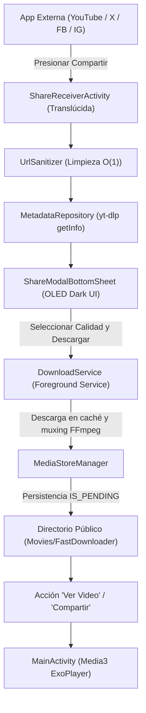

# VideAPP (FastDownloader)

[](https://kotlinlang.org)
[](https://developer.android.com/jetpack/compose)
[-34A853?logo=android)](https://developer.android.com)
[](#arquitectura-del-sistema)
[](https://github.com/yt-dlp/yt-dlp)
[](LICENSE)

> **Aplicación nativa de Android de alto rendimiento para descarga instantánea de videos vía Android Share Sheet, construida con Kotlin, Jetpack Compose, Media3 ExoPlayer y motor yt-dlp nativo embebido.**

---

## 🌟 Características Clave

- **⚡ Zero-Friction Interception:**
  Actividad translúcida (`ShareReceiverActivity`) que intercepta enlaces de `Intent.ACTION_SEND` (`text/plain`) sin abrir la aplicación a pantalla completa. Despliega un `ModalBottomSheet` OLED con retroalimentación háptica inmediata y aislamiento de tareas (`taskAffinity=""`, `noHistory="true"`, `singleInstance`), cerrándose limpiamente con `finishAndRemoveTask()` sin dejar residuos en tareas recientes.

- **🛡️ Sanitizador $\mathcal{O}(1)$ de Enlaces:**
  Limpieza de parámetros analíticos y de tracking (`?si=`, `?utm_*`, `fbclid=`, `ref=`, `igsh=`, `mibextid=`, etc.) preservando identificadores de video y marcas de tiempo en YouTube, Shorts, X (Twitter), Facebook Watch/Reels e Instagram. Suite de 13 tests unitarios automatizados con **100% PASS**.

- **🤖 Motor Local Autónomo & Blindaje Anti-403:**
  Integración de binarios nativos ARM64-v8a (`youtubedl-android` + `FFmpeg`). Implementa autoactualización asíncrona del ejecutable `yt-dlp` en canal `STABLE` y evasión de tokens SABR / Error HTTP 403 mediante argumentos cliente (`youtube:player_client=android,web`).

- **📁 Cumplimiento Estricto de Scoped Storage:**
  Almacenamiento directo en el directorio público `Movies/FastDownloader` utilizando `MediaStore API` con el flag atómico `IS_PENDING`. Cero permisos *legacy* de almacenamiento requeridos en Android 10, 11, 12, 13, 14 y 15+.

- **🔄 Descargas en Segundo Plano Resilientes:**
  `DownloadService` configurado como `foregroundServiceType="dataSync"` con notificación persistente, barra de progreso interactiva (0 a 100%), telemetría en vivo (velocidad en `MiB/s` y `ETA`), cancelación de procesos nativos y *throttling* de notificación a 500 ms para optimizar el rendimiento del sistema en One UI.

- **🎬 Biblioteca de Medios y Reproductor Media3 Integrado:**
  Pantalla principal con galería responsiva en cuadrícula de 2 columnas, miniaturas decodificadas directamente del video con Coil (`coil-video` + `VideoFrameDecoder.Factory()`) y reproductor inmersivo a pantalla completa impulsado por `androidx.media3.exoplayer`, con acciones para compartir directamente o eliminar con confirmación.

---

## 🏗️ Arquitectura del Sistema

El proyecto sigue los principios de **Clean Architecture** combinados con **MVI/MVVM**:

```
app/src/main/java/com/videapp/mobile/
├── core/
│   ├── sanitizer/          # UrlSanitizer O(1) y reconocedor de plataformas
│   └── service/            # DownloadService (Foreground dataSync Service)
├── data/
│   ├── mediastore/         # MediaStoreManager (Persistencia en Movies/FastDownloader)
│   └── repository/         # MetadataRepositoryImpl & MediaRepositoryImpl
├── domain/
│   ├── model/              # Modelos inmutables (VideoMetadata, DownloadedMedia, DownloadState)
│   └── repository/         # Contratos de repositorio (MetadataRepository, MediaRepository)
└── presentation/
    ├── main/               # MainActivity, MainViewModel, MainGalleryScreen
    ├── player/             # VideoPlayerDialog (Media3 ExoPlayer Fullscreen)
    ├── receiver/           # ShareReceiverActivity, ShareViewModel, ShareModalBottomSheet
    └── theme/              # Design System Dark OLED (Adaptado a AMOLED Galaxy S22 Ultra)
```

### Flujo de Intercepción y Descarga



---

## 🛠️ Stack Tecnológico

| Capa / Componente | Tecnología | Versión |
| :--- | :--- | :--- |
| **Lenguaje** | Kotlin | `2.0.21` |
| **Build System** | Gradle Kotlin DSL (`.kts`) | `8.9` |
| **Android Gradle Plugin** | AGP | `8.6.1` |
| **UI Framework** | Jetpack Compose BOM | `2024.10.00` |
| **Componentes de UI** | Material 3 & Navigation Compose | `1.3.0` / `2.8.3` |
| **Carga de Imágenes & Video** | Coil Compose + Coil Video | `2.7.0` |
| **Motor de Reproducción** | AndroidX Media3 (ExoPlayer) | `1.4.1` |
| **Motor Autónomo de Descarga** | `io.github.junkfood02.youtubedl-android` | `0.18.1` |
| **Muxing y Procesamiento de Medios** | FFmpeg embebido (`youtubedl-android:ffmpeg`) | `0.18.1` |
| **Concurrencia y Estado** | Kotlin Coroutines & StateFlow | `1.9.0` |
| **Pruebas Unitarias** | JUnit 4 | `4.13.2` |

---

## 📋 Requisitos de Entorno

- **Java Development Kit (JDK):** JDK 17 (LTS)
- **Android SDK:**
  - `compileSdk = 35`
  - `minSdk = 26` (Android 8.0 Oreo)
  - `targetSdk = 35` (Android 15)
- **Arquitecturas NDK Soportadas:** `arm64-v8a` (Samsung Galaxy S22 Ultra), `armeabi-v7a`, `x86_64`, `x86`.

---

## 🚀 Compilación e Instalación

### 1. Clonar el Repositorio
```bash
git clone https://github.com/NormanJaimes/VideAPP_Mobile.git
cd VideAPP_Mobile
```

### 2. Configurar `local.properties`
Asegúrate de tener la ruta a tu Android SDK en `local.properties` (este archivo está ignorado por `.gitignore`):
```properties
sdk.dir=C\:\\Users\\<TuUsuario>\\AppData\\Local\\Android\\Sdk
```

### 3. Ejecutar Pruebas Unitarias
Ejecuta la suite de pruebas del sanitizador de URLs:
```bash
./gradlew test
```

### 4. Compilar el APK de Depuración (Debug)
```bash
./gradlew assembleDebug
```
El instalador generado se ubicará en:
`app/build/outputs/apk/debug/app-debug.apk`

### 5. Instalación Directa mediante ADB
Conecta tu dispositivo vía depuración USB (ej. Samsung Galaxy S22 Ultra) o arranca un emulador y ejecuta:
```bash
adb install -r app/build/outputs/apk/debug/app-debug.apk
```

---

## 📱 Guía de Uso Rápido

1. **Descarga Instantánea vía Compartir:**
   - Abre cualquier video en **YouTube**, **X (Twitter)**, **Facebook** o **Instagram**.
   - Toca el botón **Compartir** nativo de la aplicación.
   - Selecciona **VideAPP** (o *Descargar con VideAPP*).
   - Se abrirá de inmediato el BottomSheet modal oscuro con la miniatura del video.
   - Elige el formato deseado (*Mejor Calidad*, *720p Rápido* o *Solo Audio MP3*) y pulsa **Descargar Ahora**.
   - Puedes cerrar el modal o cambiar de app; la descarga continuará en segundo plano con notificación persistente.

2. **Gestión de Medios:**
   - Abre **VideAPP** desde tu lanzador de aplicaciones.
   - Explora la biblioteca de videos descargados organizados por fecha y tamaño.
   - Toca cualquier video para reproducirlo al instante en el reproductor integrado con Media3 ExoPlayer.
   - Comparte o elimina videos directamente desde los controles de reproducción.

---

## 📄 Licencia

Este proyecto está bajo la Licencia MIT. Consulta el archivo `LICENSE` para más detalles.

